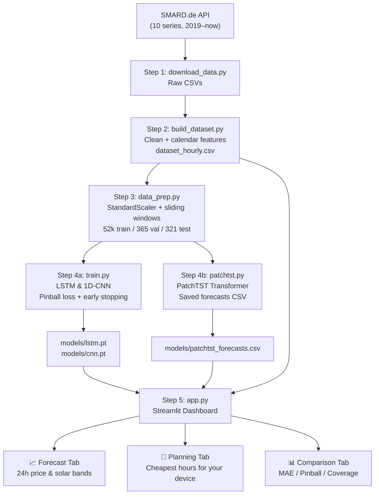

# ⚡ Smart Energy Forecasting — Complete Project Explanation

> A deep-dive into what the project does, how the data flows, how each model works, and how the Streamlit dashboard ties it all together.

---

## 📌 Table of Contents

1. [What is this project?](#1-what-is-this-project)
2. [The Dataset — where does the data come from?](#2-the-dataset)
3. [The 5-Step Pipeline](#3-the-5-step-pipeline)
4. [The 12 Input Features (explained simply)](#4-the-12-input-features)
5. [The 3 Deep Learning Models](#5-the-models)
6. [Model Comparison — which is best?](#6-model-comparison)
7. [How the Streamlit App Works](#7-how-the-streamlit-app-works)
8. [The Planning Assistant Tab](#8-the-planning-assistant)
9. [End-to-End Example](#9-end-to-end-example)
10. [How the Models Were Trained](#10-how-the-models-were-trained)

---

## 1. What is this project?

This project **predicts German electricity prices and solar generation** for the next 24 hours (day-ahead forecast). The goal is practical: help households or small businesses know **when electricity will be cheapest** so they can smartly schedule devices like electric cars and heat pumps.

The project uses data from the German electricity market (SMARD.de — public data, free to use), trains three deep-learning models on 6 years of history, and shows the results in a Streamlit web dashboard.

**Two things the app forecasts every day:**
| Target | Unit | Why it matters |
|---|---|---|
| **Electricity price** | ct/kWh (euro cents per kilowatt-hour) | Cheapest hours = best time to charge the car |
| **Solar generation** | MWh (megawatt-hours) | High solar → low price (more renewable supply) |

---

## 2. The Dataset

### Source: SMARD.de (Bundesnetzagentur)

SMARD is the German Federal Network Agency's open data platform. Data is free, publicly downloadable, and licensed CC BY 4.0.

### What series are downloaded?

| Column | Description |
|---|---|
| `price` | Wholesale spot price in the DE/LU market zone (originally EUR/MWh, converted to ct/kWh) |
| `solar` | Actual photovoltaic (solar panel) electricity generation across all of Germany |
| `wind_onshore` | Wind turbines on land |
| `wind_offshore` | Wind turbines at sea |
| `load` | Total electricity consumption (demand) in Germany |
| `residual_load` | Load minus solar & wind (the "gap" that gas/coal must fill) |

> [!NOTE]
> The dataset goes from **1 Jan 2019** to present — over 50,000 hourly rows.

### Data cleaning steps (in `build_dataset.py`)

1. **Quarter-hourly → hourly**: Since Oct 2025, prices are published every 15 min. These are averaged to hourly.
2. **Timezone fix**: Data is in UTC but Germany uses CET/CEST. The code converts to wall-clock local time.
3. **DST handling**: In October the clock goes back and 2am appears twice — the duplicate is dropped. In March the clock jumps forward and 2am is missing — that NaN is filled by interpolation.
4. **Gap filling**: Gaps up to 3 consecutive hours are linearly interpolated. Rows with longer gaps (must-have columns still NaN) are dropped entirely.
5. **Price unit conversion**: EUR/MWh ÷ 10 = ct/kWh.

### Time split (never shuffle!)

Since this is time-series data, the split **must be sequential** — you can't randomly pick rows because that would leak future information into training.

```
2019-01-01  ────────────────────────  2024-12-31  |  2025-01-01  ───  2025-12-31  |  2026-01-01  ──► today
       TRAIN  (~52,000 windows)                             VALIDATION (365 days)        TEST (321 days)
                                                        (used to pick best model)      (final score, used ONCE)
```

---

## 3. The 5-Step Pipeline

```
Step 1: download_data.py    → downloads raw CSVs from SMARD API
Step 2: build_dataset.py    → cleans, merges, adds features → dataset_hourly.csv
Step 3: data_prep.py        → scales data, creates sliding windows for training
Step 4: train.py            → trains LSTM & 1D-CNN with early stopping
        patchtst.py         → trains PatchTST Transformer (optional, GPU recommended)
Step 5: app.py (Streamlit)  → interactive forecasting + planning assistant
```

To run from scratch:
```bash
python -m src.download_data        # ~10 min — downloads 10 series × 7 years
python -m src.build_dataset        # builds dataset_hourly.csv
python -m src.train                # trains LSTM + CNN (~15 min on MPS/GPU)
python -m src.patchtst             # trains PatchTST (optional)
streamlit run app.py               # launches the dashboard
```

---

## 4. The 12 Input Features

The model sees the **last 168 hours (7 days)** of data before making a forecast. Each hour is described by 12 numbers:

| # | Feature | Type | Explanation |
|---|---|---|---|
| 1 | `price` | energy | Last week's electricity price — the most direct signal |
| 2 | `solar` | energy | Solar generation — when it's high, prices usually drop |
| 3 | `wind_onshore` | energy | Land wind generation |
| 4 | `wind_offshore` | energy | Sea wind generation |
| 5 | `load` | energy | Total German electricity demand |
| 6 | `residual_load` | energy | Demand that must be met by fossil fuels |
| 7 | `is_weekend` | calendar | 0 or 1 — industry demand is lower on weekends |
| 8 | `is_holiday` | calendar | 0 or 1 — German public holidays |
| 9 | `hour_sin` | calendar | sin(2π × hour / 24) — encodes the hour cyclically |
| 10 | `hour_cos` | calendar | cos(2π × hour / 24) — paired with hour_sin |
| 11 | `doy_sin` | calendar | Day-of-year as a cycle — captures seasonal patterns |
| 12 | `doy_cos` | calendar | Paired with doy_sin |

> [!TIP]
> **Why sin/cos for time?** If you just use the number 23 for 11pm, the model thinks it's "far" from hour 0 (midnight). Using `sin(hour)` + `cos(hour)` makes midnight and 11pm correctly close together on a circle.

**Input shape going into every model:** `(batch_size, 168 hours, 12 features)`

**Output shape from every model:** `(batch_size, 24 hours, 2 targets, 3 quantiles)`
- 2 targets: price and solar
- 3 quantiles: **low (10%)**, **middle (50%)**, **high (90%)**

---

## 5. The Models

### Model A — LSTM (Long Short-Term Memory)

**File:** `src/models.py` — class `LSTMForecaster`

**What is LSTM?** A type of recurrent neural network that processes the sequence hour-by-hour and uses "memory cells" (like a moving notepad) to remember important things from earlier in the week.

```
Input (168 hours) → [LSTM reads hour 1] → [LSTM reads hour 2] → ... → [LSTM reads hour 168]
                                                                              ↓
                                                                   hidden state = "summary of the week"
                                                                              ↓
                                                                   Linear head → 144 numbers
                                                                              ↓
                                                            reshape to (24, 2, 3) = forecast
```

**Architecture:**
- 2 stacked LSTM layers, each with 128 hidden units
- Dropout 10% (regularization against overfitting)
- Fully connected head: `128 → 128 → ReLU → 144` outputs

**Analogy:** Imagine reading the entire week's data word-by-word like a story. By the end you've understood the narrative and can predict what happens tomorrow.

---

### Model B — 1D-CNN (Dilated Causal Convolution)

**File:** `src/models.py` — class `CNNForecaster`

**What is a dilated causal CNN?** Instead of reading left-to-right, the CNN looks at the whole week simultaneously using filters (small windows that slide along the time axis). "Causal" means it can only look at past hours (no peeking at the future). "Dilated" means consecutive layers look further and further back.

```
Dilation 1:  [h1,h2,h3,h4]  [h2,h3,h4,h5]  ...   ← looks at 4 consecutive hours
Dilation 2:  [h1, h3, h5, h7]               ...   ← skips every other hour
Dilation 4:  [h1, h5, h9, h13]              ...   ← even wider view
...
Dilation 32: [h1, h33, h65, h97]            ...   ← sees almost the full week
```

6 stacked dilated blocks → receptive field of **190 hours** (covers the full 168h input).

**Architecture:**
- Input projection: `12 features → 64 filters`
- 6 × CausalConvBlock (kernel size 4, dilation 1,2,4,8,16,32)
- Output summary: concatenate `[last_step_features, mean_over_time]` → `128 features`
- Head: `128 → 128 → ReLU → 144` outputs

**Analogy:** Like scanning the week with a magnifying glass that gets progressively wider, capturing both local patterns (what happened in the last 4 hours) and global trends (what this season/day-of-week usually looks like).

---

### Model C — PatchTST (Patch Time Series Transformer)

**File:** `src/patchtst.py` — uses the `neuralforecast` library

**What is it?** A Transformer (like GPT, but for time-series) that splits the 168-hour history into **patches of 24 hours each** (7 patches = 7 days), then uses self-attention to see which past day is most relevant to tomorrow.

```
168h history → split into 7 patches of 24h each
               [Day-7] [Day-6] [Day-5] [Day-4] [Day-3] [Day-2] [Day-1]
                             ↓ Attention mechanism ↓
                  "Today looks like last Thursday — weight that heavily"
                             ↓
                        Forecast: 24h ahead
```

**Key settings:**
- `patch_len=24, stride=24` — non-overlapping daily patches
- `input_size=168` — 7 days of history
- `loss=MQLoss(level=[80])` — directly optimises for the 10%/50%/90% quantile band

> [!IMPORTANT]
> PatchTST was run once on the notebook (or Colab) and its forecasts **saved to `models/patchtst_forecasts.csv`**. The app reads this CSV instead of re-running inference, since training requires a GPU for practical speed.

---

### Baselines

Two simple baselines are provided to show that "just copying from last week" is not trivially beatable:

| Baseline | Forecast for tomorrow 14:00 |
|---|---|
| **Same hour last week** | The price at last Thursday 14:00 |
| **Same hour yesterday** | The price at yesterday 14:00 |

These are turned into `low/mid/high` bands using the residual distribution from the training set.

---

## 6. Model Comparison

The metrics below are from **`models/results_test.csv`** — the **final test set** (2026 data, used only once after all training decisions were made).

### 📊 Electricity Price Forecast (ct/kWh)

| Model | MAE ↓ | RMSE ↓ | Plinbal ↓ | Coverage |
|---|---|---|---|---|
| **PatchTST** ⭐ | **2.588** | **4.007** | **0.844** | **80.4%** |
| 1D-CNN | 2.656 | 4.021 | 0.872 | 73.3% |
| LSTM | 3.091 | 4.452 | 1.015 | 67.8% |
| Baseline (yesterday) | 3.327 | 5.158 | 1.192 | 72.8% |
| Baseline (last week) | 4.461 | 6.789 | 1.599 | 71.0% |

### 📊 Solar Generation Forecast (MWh)

| Model | MAE ↓ | RMSE ↓ | Pinball ↓ | Coverage |
|---|---|---|---|---|
| **PatchTST** ⭐ | **2,223** | **4,214** | **722.8** | **81.5%** |
| Baseline (yesterday) | 2,254 | 4,644 | 803.9 | 57.6% |
| 1D-CNN | 2,461 | 4,517 | 855.6 | 64.6% |
| LSTM | 2,482 | 4,525 | 859.6 | 63.1% |
| Baseline (last week) | 3,462 | 6,642 | 1,191.7 | 53.5% |

### Metric glossary

| Metric | What it means | Lower is better? |
|---|---|---|
| **MAE** | Average absolute error of the middle forecast | ✅ lower = better |
| **RMSE** | Like MAE but penalises large errors more heavily | ✅ lower = better |
| **Pinball** | Quality of the full low/mid/high band (quantile loss) | ✅ lower = better |
| **Coverage** | % of real values that fall inside the low-high band. Goal ≈ 80% | 🎯 closer to 80% |
| **BandWidth** | Average gap between low and high — indicates uncertainty | depends on context |

### 🏆 Which model is best?

**PatchTST wins clearly on both targets** — lowest MAE, lowest Pinball, and the only model hitting the target 80% coverage on both price and solar. Its Transformer attention mechanism is better at capturing which historical day is most similar to today (e.g., weather patterns, weekday effects).

**1D-CNN is the best of the two trained-from-scratch models** — it beats LSTM on every single metric for price. For solar the gap is tiny (CNN 2461 vs LSTM 2482 MAE), but CNN converges faster (early stopped at epoch 7 vs LSTM epoch 4).

**LSTM is decent but underperforms on coverage** — only 67.8% of price values fall inside its band (vs target 80%). This means the model is too confident: it predicts narrow bands that miss the actual value too often.

**Baselines are surprisingly competitive** — "same hour yesterday" beats both LSTM and CNN on solar MAE! This is a known quirk of solar forecasting: yesterday's solar is a strong predictor because weather is autocorrelated. The DL models only clearly win on the band quality (Pinball + Coverage).

---

## 7. How the Streamlit App Works

The app has **3 tabs** and a **sidebar** for controls.

### Sidebar controls

```
⚡ Smart Energy
  Mode: [Demo (test period)] [Real (tomorrow)]
  Model: [1D-CNN ▼]
  Day to forecast: [2026-11-10 ▲▼]
```

- **Demo mode**: Pick any past 2026 test day and see the forecast **plus** the real values (you can verify accuracy).
- **Real mode**: Download the newest SMARD data and forecast tomorrow. *(Requires internet.)*

### Tab 1 — 📈 Forecast

When you pick a day and model, the app:

1. **Loads the last 168 hours** of `dataset_hourly.csv` ending at midnight of the chosen day.
2. **Scales the input** using the StandardScaler (fitted on training data only).
3. **Runs the model** (LSTM or CNN: a forward pass through PyTorch; PatchTST: looks up the pre-saved CSV).
4. **Unscales the output** back to real units.
5. **Clips solar to ≥ 0** (the model can predict tiny negatives; physically impossible).
6. **Builds a Plotly chart** showing:
   - Shaded band: low (10%) → high (90%) — the uncertainty range
   - Solid line: middle forecast (50%)
   - Dotted grey line: actual (if available)

**KPI cards shown:**
- Average price (forecast)
- Cheapest hour of the day
- Most expensive hour of the day
- Total solar energy

**Example reading:**
> *CNN forecast for 10 Nov 2026: cheapest hour is 13:00 at 2.3 ct/kWh (midday solar peak), most expensive is 18:00 at 8.1 ct/kWh (evening demand spike, no solar). Average price 5.4 ct/kWh.*

### Tab 2 — 🤖 Planning Assistant

This tab solves an **optimisation problem**: given the energy forecast, pick the cheapest hours to run a device.

**Inputs:**
- Task: Electric car / Heat pump
- Energy needed (kWh): e.g. 20 kWh
- Device power (kW): e.g. 11 kW
- Allowed time window: e.g. 22:00 → 07:00
- Mode: Normal (use middle forecast) or Safe (use upper price to avoid surprises)

**What it calculates (in `src/planner.py`):**
1. `hours_needed = ceil(20 kWh / 11 kW) = 2 hours`
2. Filter the forecast to the allowed window (22:00–07:00 = 9 hours available)
3. Pick the 2 cheapest hours from those 9
4. Assign the partial last slot to the most expensive of the chosen 2 hours (minimises total cost)
5. Compute estimated cost, range, and saving vs. starting immediately

**Example output:**
> *Run at 02:00 and 03:00 (both 2.1 ct/kWh). Estimated cost: 0.42 EUR. Saves 0.31 EUR vs. plugging in at 22:00.*

The optional **AI explanation** (requires an Anthropic API key in `.streamlit/secrets.toml`) calls Claude to write a plain-English justification.

### Tab 3 — 📊 Model Comparison

Loads `models/results_val.csv` and `models/results_test.csv` and displays them as tables — the same data shown in [Section 6](#6-model-comparison) above.

---

## 8. The Planning Assistant

The planner (`src/planner.py`) is a greedy knapsack solver:

```python
# Pseudocode
hours_needed = ceil(energy_kwh / power_kw)         # e.g., ceil(20/11) = 2
window = forecast[22:00 to 07:00]                  # 9 candidate hours
chosen = window.nsmallest(hours_needed, "price_mid")# pick 2 cheapest
# assign energy: full power in all but the last slot, partial in the last
cost = sum(chosen.price_mid * chosen.energy_kwh) / 100   # ct→EUR
savings = naive_cost - cost                         # vs. starting right away
```

**Safe mode** sorts by `price_hi` instead of `price_mid` — this avoids selecting hours where the upper uncertainty band is high, giving a safer (if slightly pricier) plan.

---

## 9. End-to-End Example

> **Scenario:** It's Monday 10 Nov 2026. I want to charge my electric car overnight. It needs 20 kWh, my charger is 11 kW, and I can plug in anytime from 22:00 to 07:00.

### Step 1 — The model forecasts tomorrow's prices

The 1D-CNN takes the 168-hour window ending at **10 Nov 2026 00:00** and outputs:

```
Hour    Low     Mid     High
22:00   3.1     4.2     5.8   ct/kWh
23:00   2.8     3.9     5.3
00:00   2.1     3.1     4.8   ← cheapest hours
01:00   2.0     3.0     4.5
02:00   2.3     3.4     5.0
03:00   2.9     4.1     6.0
04:00   3.5     4.8     6.5
05:00   4.1     5.2     7.1
06:00   5.3     6.9     9.0   ← most expensive in window
```

### Step 2 — The planner picks the 2 cheapest hours

```
hours_needed = ceil(20 / 11) = 2
Chosen: 00:00 (3.0 ct/kWh) and 01:00 (3.0 ct/kWh)
  - Hour 00:00: 11 kW for 1 hour = 11 kWh
  - Hour 01:00:  9 kW for 1 hour =  9 kWh (the remainder to reach 20 kWh)
Cost = (3.0 × 11 + 3.0 × 9) / 100 = 0.60 EUR
```

### Step 3 — Savings calculation

```
If you just plugged in at 22:00:
  22:00: 11 kWh @ 4.2 ct → 0.462 EUR
  23:00:  9 kWh @ 3.9 ct → 0.351 EUR
  Naive cost = 0.813 EUR

Savings = 0.813 - 0.60 = 0.21 EUR  (about 26% cheaper!)
```

### Step 4 — The app shows this in the dashboard

- Forecast chart highlights the two chosen hours with green stars ⭐
- KPI: "Saving vs. starting right away: **0.21 €**"
- AI explanation (if key provided) writes a paragraph about why midday solar makes early-morning hours cheapest.

---

## 10. How the Models Were Trained

### Training details (from `src/train.py` and `src/config.py`)

| Setting | Value |
|---|---|
| Optimizer | Adam |
| Learning rate | 0.001 |
| Batch size | 64 windows |
| Max epochs | 50 |
| Early stopping patience | 5 epochs (stop if val loss doesn't improve) |
| Loss function | **Pinball loss** (quantile loss for 3 quantiles simultaneously) |
| Seed | 42 |
| Device used | Apple MPS (Metal GPU on the M-series Mac) |

### What is Pinball Loss?

For each of the 3 quantiles (q = 0.1, 0.5, 0.9), the pinball loss asymmetrically penalises errors:

$$\text{Pinball}(q, y, \hat{y}) = \begin{cases} q \cdot (y - \hat{y}) & \text{if } y \geq \hat{y} \\ (q-1) \cdot (y - \hat{y}) & \text{if } y < \hat{y} \end{cases}$$

- For the **10% quantile**: being too high is penalised 10×, being too low 90× → forces the prediction to be a genuine low estimate.
- For the **90% quantile**: being too low is penalised 90×, too high 10× → forces a genuine high estimate.
- For the **50% quantile**: symmetric → like MAE.

Training the three quantiles jointly means the model outputs **calibrated uncertainty bands**, not just a point prediction.

### Training run (actual log from `models/train_log.txt`)

```
windows: train 52417, val 365, test 321   device: mps

[cnn] epoch  1  train 0.0740  val 0.0725
[cnn] epoch  7  train 0.0449  val 0.0641  ← best val
[cnn] epoch  12  ...  val 0.0772
[cnn] early stopping at epoch 12 (patience=5 after epoch 7)
Saved models/cnn.pt

[lstm] epoch  1  train 0.0819  val 0.0771
[lstm] epoch  4  train 0.0478  val 0.0669  ← best val
[lstm] epoch  9  ...  val 0.0827
[lstm] early stopping at epoch 9 (patience=5 after epoch 4)
Saved models/lstm.pt
```

> [!NOTE]
> The CNN reached a better validation Pinball (0.0641 vs LSTM's 0.0669) **and** converged faster (7 epochs vs 4), confirming it's the stronger of the two custom-trained models.

### Sliding window logic

Training uses **every possible 168-hour window** that fits in the training period — about 52,000 examples. Val and test only use **midnight-starting windows** (one per day) since the app always forecasts a full day ahead.

```
Training window example:
  Input:   2022-03-14 01:00 → 2022-03-21 00:00  (168h, 12 features)
  Target:  2022-03-21 01:00 → 2022-03-22 00:00  (24h, price + solar, 3 quantiles)
```

---

## Summary


